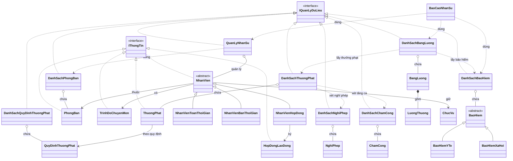

# Hệ thống Quản lý Nhân sự

Ứng dụng **console** viết bằng **Java thuần (hướng đối tượng)**, quản lý nhân viên, phòng ban, chấm công, nghỉ phép, bảo hiểm, thưởng/phạt, bảng lương và báo cáo thống kê. Dữ liệu lưu bằng **file text** trong thư mục `data/`, không cần cơ sở dữ liệu hay thư viện ngoài.

> Tài liệu này mô tả **code thực tế** của dự án (đã chốt). Cách sử dụng chi tiết từng menu xem file [`HUONGDAN.md`](HUONGDAN.md).

---

## Mục lục

1. [Tính năng chính](#1-tính-năng-chính)
2. [Chạy nhanh](#2-chạy-nhanh)
3. [Cấu trúc thư mục](#3-cấu-trúc-thư-mục)
4. [Kiến thức OOP được áp dụng](#4-kiến-thức-oop-được-áp-dụng)
5. [Danh sách class](#5-danh-sách-class)
6. [Quan hệ giữa các class](#6-quan-hệ-giữa-các-class)
7. [Phân công nhóm 5 người](#7-phân-công-nhóm-5-người)
8. [Phối hợp giữa các thành viên](#8-phối-hợp-giữa-các-thành-viên)
9. [Quy ước chung](#9-quy-ước-chung)

---

## 1. Tính năng chính

- Quản lý hồ sơ nhân viên: **toàn thời gian, bán thời gian, hợp đồng** (thêm, sửa, xóa, tìm kiếm chính xác/gần đúng, tìm theo phòng ban, theo khoảng lương).
- Quản lý phòng ban, chức vụ, trình độ chuyên môn.
- Chấm công, tính giờ làm thường và giờ tăng ca, thống kê theo tháng.
- Tạo và duyệt đơn nghỉ phép.
- Quản lý bảo hiểm xã hội (BHXH), bảo hiểm y tế (BHYT), tính tiền nhân viên và doanh nghiệp đóng.
- Quy định thưởng/phạt, **tự động xét thưởng/phạt** theo chấm công và nghỉ phép.
- Lập bảng lương hàng tháng, xem theo nhân viên hoặc cả công ty.
- Báo cáo toàn công ty và theo phòng ban.
- Giao diện console dạng **bảng có cột STT**, mỗi lần nhập/xuất nằm trong khung `-----`.
- Đọc/ghi dữ liệu từ file text.

---

## 2. Chạy nhanh

Yêu cầu: **JDK 11 trở lên**, terminal rộng khoảng 110 ký tự trở lên.

**VS Code:** mở thư mục dự án, mở `src/Main.java`, bấm **F5** (hoặc nút ▶ Run).

**Dòng lệnh:**

```
cd Build-an-application-manager/src
javac -encoding UTF-8 *.java
java Main
```

Chương trình tự tìm thư mục `data/` dù chạy từ `src`, `Build-an-application-manager` hay `OOP(PRJ)`. Dữ liệu mẫu (12 nhân viên, 5 phòng ban, chấm công tháng 10/2026...) được nạp sẵn.

---

## 3. Cấu trúc thư mục

```
Build-an-application-manager/
├── README.md        ← tài liệu này
├── HUONGDAN.md      ← hướng dẫn sử dụng chi tiết
├── src/             ← mã nguồn (32 file .java)
└── data/            ← dữ liệu dạng file text, tự nạp khi khởi động
    ├── phongban.txt
    ├── nhanvien.txt
    ├── chamcong.txt
    ├── nghiphep.txt
    ├── baohiem.txt
    ├── quydinhthuongphat.txt
    ├── thuongphat.txt
    └── bangluong.txt
```

---

## 4. Kiến thức OOP được áp dụng

| Khái niệm | Thể hiện trong dự án |
|---|---|
| **Kế thừa** | `NhanVien` (abstract) → `NhanVienToanThoiGian`, `NhanVienBanThoiGian`, `NhanVienHopDong`. `BaoHiem` (abstract) → `BaoHiemXaHoi`, `BaoHiemYTe` |
| **Trừu tượng** | `NhanVien.tinhLuong()`, `BaoHiem.tinhTienNhanVienDong()`, `BaoHiem.tinhTienDoanhNghiepDong()` là phương thức abstract, lớp con bắt buộc cài đặt |
| **Đa hình** | Mỗi loại nhân viên tính lương khác nhau nhưng được gọi chung qua `nv.tinhLuong()`. `NhanVien.hienThiThongTin()` dựng phần chung rồi gọi `thongTinRieng()` mà từng lớp con ghi đè. Mảng `NhanVien[]` chứa cả 3 loại |
| **Interface** | `IThongTin` (`hienThiThongTin()`), `IQuanLyDuLieu` (`docFile()`, `ghiFile()`) |
| **Đóng gói** | Thuộc tính `private`, truy cập qua getter/setter, setter kiểm tra dữ liệu hợp lệ và ném `IllegalArgumentException` |
| **Static** | `NhanVien.soLuongNV`, `BangLuong.LUONG_TOI_THIEU`, tỷ lệ đóng bảo hiểm, các lớp tiện ích `TepVanBan`, `DuongDanDuLieu`, `GiaoDien` |
| **Nạp chồng (overloading)** | Nhiều constructor ở `ThuongPhat`, `BangLuong`, `BaoCaoNhanSu`; `DanhSachChamCong.thongKeGioLam(maNV, thang)` và `(maNV, thang, nam)` |
| **Kết tập / hợp thành** | Các lớp `DanhSach...` chứa mảng đối tượng; `BangLuong` chứa `LuongThuong[]`; `NhanVienHopDong` tạo `HopDongLaoDong` |
| **Mảng đối tượng** | Toàn bộ danh sách dùng mảng (không dùng `ArrayList`) với sức chứa cố định |

---

## 5. Danh sách class

### 5.1. Interface

| Class | Vai trò |
|---|---|
| `IThongTin` | Hợp đồng cho các class biết tự hiển thị: `hienThiThongTin()`. Cài đặt bởi `NhanVien`, `HopDongLaoDong`, `PhongBan`, `TrinhDoChuyenMon`, `ThuongPhat` |
| `IQuanLyDuLieu` | Hợp đồng cho các class đọc/ghi file: `docFile()`, `ghiFile()`. Cài đặt bởi tất cả các class `DanhSach...` và `QuanLyNhanSu` |

### 5.2. Nhân viên

| Class | Vai trò | Phương thức chính |
|---|---|---|
| `NhanVien` *(abstract)* | Lớp cha của mọi nhân viên | `tinhLuong()` *(abstract)*, `hienThiThongTin()` (bảng chi tiết), `thongTinRieng()`, `tenLoai()`, `setPhongBan()`, `setChucVu()`, `setTrinhDo()`, `chamCong()`, `tinhThuongPhat()`, `tienBaoHiem()` |
| `NhanVienToanThoiGian` | Nhân viên toàn thời gian | Thêm `phuCap`, `thamNien`; lương = cơ bản + phụ cấp + thâm niên × 200.000 |
| `NhanVienBanThoiGian` | Nhân viên bán thời gian | Thêm `soGioLam`, `luongTheoGio`; lương = số giờ × lương giờ |
| `NhanVienHopDong` | Nhân viên hợp đồng | Thêm thời hạn, lương hợp đồng, ngày thực tế; `tinhThoiGianThucTe()`, `kiemTraDungHan()`, tự tạo `HopDongLaoDong` |
| `HopDongLaoDong` | Hợp đồng lao động | `giaHan()`, `conHieuLuc()` |
| `ChucVu` | Chức vụ và hệ số phụ cấp | `tinhPhuCapChucVu(luongCoBan)` |
| `TrinhDoChuyenMon` | Trình độ học vấn | `tinhPhuCapTrinhDo(luongCoBan)` |

### 5.3. Tổ chức và quản lý nhân sự

| Class | Vai trò | Phương thức chính |
|---|---|---|
| `QuanLyNhanSu` | Quản lý mảng `NhanVien[]` | `themNhanVien()`, `xoaNhanVien()`, `suaNhanVien()`, `capNhatThongTinCoBan()`, `timTheoMa()`, `timKiemTuKhoa()`, `timKiemGanDung()`, `timKiemUuTien()`, `timKiemTheoPhongBan()`, `timKiemTheoLuong()`, `thongKeTheoLoaiNv()`, `thongKeTheoTrangThai()`, `thongKeLuong()`, `inBang()`, `docFile()`, `ghiFile()` |
| `PhongBan` | Một phòng ban | `demNhanVien()`, `tangSoNhanVien()`, `giamSoNhanVien()` |
| `DanhSachPhongBan` | Quản lý mảng `PhongBan[]` | `themPhong()`, `xoaTheoMa()` (chặn khi còn nhân viên), `suaTheoMa()`, `timTheoMa()`, `timKiem()`, `inBang()` |

### 5.4. Chấm công và nghỉ phép

| Class | Vai trò | Phương thức chính |
|---|---|---|
| `ChamCong` | Một lần chấm công | `tinhGioLam()` (tối đa 8 giờ thường), `tinhGioTangCa()` |
| `DanhSachChamCong` | Quản lý chấm công | `them()`, `xoaTheoMa()`, `thongKeGioLam()`, `thongKeGioTangCa()`, `thongKeSoNgayDiLam()` (có bản theo tháng và theo tháng + năm) |
| `NghiPhep` | Một đơn nghỉ phép | `duyetNghiPhep()`, `tinhSoNgayNghi()` |
| `DanhSachNghiPhep` | Quản lý đơn nghỉ phép | `them()`, `duyetTheoMa()`, `xoaTheoMa()`, `timTheoMaNV()`, `inBang()` |

### 5.5. Bảo hiểm

| Class | Vai trò | Phương thức chính |
|---|---|---|
| `BaoHiem` *(abstract)* | Lớp cha bảo hiểm | `tinhTienNhanVienDong()`, `tinhTienDoanhNghiepDong()` *(abstract)* |
| `BaoHiemXaHoi` | BHXH | Tỷ lệ nhân viên đóng 8%, doanh nghiệp 17,5% |
| `BaoHiemYTe` | BHYT | Tỷ lệ 1,5% và 3%; thêm nơi khám chữa bệnh, hạn thẻ; `conHanThe()` |
| `DanhSachBaoHiem` | Quản lý bảo hiểm | `them()`, `xoaTheoMa()`, `timTheoMaNV()`, `tongTienNhanVienDong()`, `tongTienDoanhNghiepDong()`, `inBang()` |

### 5.6. Lương, thưởng/phạt

| Class | Vai trò | Phương thức chính |
|---|---|---|
| `BangLuong` | Phiếu lương 1 nhân viên 1 tháng | `tinhTongLuong()`, `tinhLuongThucNhan()`, `themLuongThuong()`, `xuatBangLuong()` |
| `LuongThuong` | Một khoản thưởng hoặc phạt nằm trong bảng lương | `tinhThuong()`, `tinhPhat()` |
| `DanhSachBangLuong` | Quản lý bảng lương | `lapBangLuong()`, `lapBangLuongChoTatCa()`, `xuatBangLuongNhanVien()`, `xuatBangLuongCongTy()`, `tongQuyLuong()`, `luongCaoNhat()`, `luongThapNhat()`, `luongTrungBinh()` |
| `QuyDinhThuongPhat` | Một quy định thưởng/phạt | `kiemTraDieuKien()`, `tinhTien()`, `laThuong()` |
| `DanhSachQuyDinhThuongPhat` | Quản lý quy định | `them()`, `xoaTheoMa()`, `timTheoMa()` |
| `ThuongPhat` | Một khoản thưởng/phạt phát sinh | `tinhSoTien()` |
| `DanhSachThuongPhat` | Quản lý thưởng/phạt | `them()`, `xoaTheoMa()`, `timTheoMaNV()`, `tongThuong()`, `tongPhat()`, `tuDongXetThuongPhat()` |

**Công thức lương:**

```
Tổng lương = Lương nhân viên + Phụ cấp + Tiền thưởng − Tiền phạt
Thực nhận  = Tổng lương − Tiền bảo hiểm nhân viên đóng
```

### 5.7. Báo cáo

| Class | Vai trò | Phương thức chính |
|---|---|---|
| `BaoCaoNhanSu` | Tổng hợp thống kê, không lưu dữ liệu riêng | `thongKeNhanSu()`, `thongKeTheoPhongBan()`, `thongKeLuong()`, `thongKeBaoHiem()`, `thongKeHoatDongVaNghi()`, `inBaoCaoToanCongTy()`, `inBaoCaoTheoPhong()` |

### 5.8. Tiện ích và điểm khởi chạy

| Class | Vai trò |
|---|---|
| `TepVanBan` | Đọc/ghi file text dùng chung (`docDong`, `ghiDong`, `ghep`, `soDep`) |
| `DuongDanDuLieu` | Xác định thư mục `data/` dù chạy từ đâu |
| `GiaoDien` | Vẽ khung `-----`, in bảng có STT, tự xuống dòng khi chữ dài. Độ rộng chỉnh bằng hằng `DO_RONG` |
| `Main` | Điểm khởi chạy: menu console, nối tất cả các class lại, nạp/lưu dữ liệu. Mỗi chức năng được bọc trong khung bằng hàm `chay()` |

---

## 6. Quan hệ giữa các class

### Kế thừa và cài đặt

| Class con | Class cha / Interface |
|---|---|
| `NhanVienToanThoiGian`, `NhanVienBanThoiGian`, `NhanVienHopDong` | `NhanVien` (abstract) |
| `BaoHiemXaHoi`, `BaoHiemYTe` | `BaoHiem` (abstract) |
| `NhanVien`, `HopDongLaoDong`, `PhongBan`, `TrinhDoChuyenMon`, `ThuongPhat` | `IThongTin` |
| `QuanLyNhanSu` và tất cả class `DanhSach...` | `IQuanLyDuLieu` |

### Phụ thuộc giữa các class chính

| Class | Dùng class | Để làm gì |
|---|---|---|
| `QuanLyNhanSu` | `DanhSachPhongBan` | Kiểm tra và cập nhật số nhân viên của phòng ban |
| `DanhSachBangLuong` | `DanhSachThuongPhat`, `DanhSachBaoHiem` | Lấy tiền thưởng/phạt và tiền bảo hiểm khi lập lương |
| `DanhSachBangLuong` | `QuanLyNhanSu` | Lấy nhân viên theo phòng ban |
| `DanhSachThuongPhat` | `DanhSachChamCong`, `NghiPhep`, `QuyDinhThuongPhat` | Tự động xét thưởng/phạt |
| `BaoCaoNhanSu` | `QuanLyNhanSu`, `DanhSachBangLuong`, `DanhSachBaoHiem` | Lấy số liệu để thống kê |
| `NhanVienHopDong` | `HopDongLaoDong` | Tạo hợp đồng tương ứng |
| `Main` | Tất cả | Điều phối menu |

### Sơ đồ rút gọn



---

## 7. Phân công nhóm 5 người

Phân công theo **class** (không chia theo menu). Mỗi người phụ trách **viết/duy trì, giải thích code và demo** phần của mình. Số dòng giữa các thành viên được cân đối để khối lượng tương đương (khoảng 860 đến 980 dòng mỗi người).

### 7.1. Bảng tổng quát

| Người | Mảng phụ trách | Số class | Số dòng | Class |
|---|---|---|---|---|
| **1** | Lõi nhân viên | 8 | ~861 | `NhanVien`, `NhanVienToanThoiGian`, `NhanVienBanThoiGian`, `NhanVienHopDong`, `HopDongLaoDong`, `ChucVu`, `TrinhDoChuyenMon`, `IThongTin` |
| **2** | Quản lý nhân sự và phòng ban | 4 | ~930 | `QuanLyNhanSu`, `PhongBan`, `DanhSachPhongBan`, `IQuanLyDuLieu` |
| **3** | Chấm công, nghỉ phép, bảo hiểm, báo cáo | 11 | ~960 | `ChamCong`, `DanhSachChamCong`, `NghiPhep`, `DanhSachNghiPhep`, `BaoHiem`, `BaoHiemXaHoi`, `BaoHiemYTe`, `DanhSachBaoHiem`, `BaoCaoNhanSu`, `TepVanBan`, `DuongDanDuLieu` |
| **4** | Bảng lương và thưởng/phạt | 7 | ~888 | `BangLuong`, `DanhSachBangLuong`, `LuongThuong`, `ThuongPhat`, `DanhSachThuongPhat`, `QuyDinhThuongPhat`, `DanhSachQuyDinhThuongPhat` |
| **5** | Main và giao diện | 2 | ~980 | `Main`, `GiaoDien` |

> **Người 5 chỉ cần phụ trách `Main` và `GiaoDien`, không cần nhận thêm class nào khác.** Riêng `Main.java` đã khoảng 758 dòng và là nơi nối tất cả các phần, nên khối lượng đã đủ.

Tổng cộng 32 class, không sót, không trùng.

---

### 7.2. Người 1: Lõi nhân viên (nền tảng của hệ thống)

**Class:** `NhanVien` *(abstract)*, `NhanVienToanThoiGian`, `NhanVienBanThoiGian`, `NhanVienHopDong`, `HopDongLaoDong`, `ChucVu`, `TrinhDoChuyenMon`, `IThongTin`.

**Trách nhiệm:**
- Thiết kế lớp cha trừu tượng `NhanVien` và 3 lớp con, mỗi loại tính lương theo công thức riêng.
- Cài đặt bảng chi tiết nhân viên: `hienThiThongTin()` dựng phần chung, `thongTinRieng()` do lớp con ghi đè.
- Kiểm tra dữ liệu hợp lệ trong setter (ném `IllegalArgumentException`).
- `NhanVienHopDong` tự tạo `HopDongLaoDong` và tính thời gian thực tế.
- `ChucVu`, `TrinhDoChuyenMon` cung cấp hệ số để tính phụ cấp.

**Cần nắm để vấn đáp:**
- Vì sao `NhanVien` là abstract, và `tinhLuong()` được gọi như thế nào khi mảng chứa cả 3 loại (đa hình).
- Khác nhau về công thức lương của 3 loại nhân viên.
- `IThongTin` được những class nào cài đặt và để làm gì.

**Tự kiểm tra:** Menu **2 → 11** (xem chi tiết) với `NV001` (toàn thời gian), `NV007` (bán thời gian), `NV010` (hợp đồng) để thấy phần riêng của từng loại.

---

### 7.3. Người 2: Quản lý nhân sự và phòng ban

**Class:** `QuanLyNhanSu`, `PhongBan`, `DanhSachPhongBan`, `IQuanLyDuLieu`.

**Trách nhiệm:**
- `QuanLyNhanSu`: quản lý mảng `NhanVien[]`, gồm thêm, sửa, xóa, tìm kiếm (từ khóa, gần đúng, ưu tiên khớp chính xác), tìm theo phòng ban, theo khoảng lương.
- Các hàm thống kê: theo loại nhân viên (dùng `instanceof`), theo trạng thái, thống kê lương.
- `PhongBan`: đếm số nhân viên (`tangSoNhanVien()`, `giamSoNhanVien()`). `DanhSachPhongBan`: không cho xóa phòng còn nhân viên.
- Đọc/ghi file `nhanvien.txt`, `phongban.txt` (cài đặt `IQuanLyDuLieu`).

**Cần nắm để vấn đáp:**
- Vì sao một mảng `NhanVien[]` chứa được 3 loại nhân viên.
- Thuật toán tìm kiếm ưu tiên (chính xác trước, gần đúng sau).
- Vì sao phải kiểm tra khi xóa phòng ban.

**Tự kiểm tra:** Menu **1** (phòng ban: thử xóa `PB02` bị từ chối, xóa `PB05` được) và menu **2** mục 1, 3, 4, 5, 6, 7, 8, 9, 10.

---

### 7.4. Người 3: Chấm công, nghỉ phép, bảo hiểm, báo cáo

**Class:** `ChamCong`, `DanhSachChamCong`, `NghiPhep`, `DanhSachNghiPhep`, `BaoHiem` *(abstract)*, `BaoHiemXaHoi`, `BaoHiemYTe`, `DanhSachBaoHiem`, `BaoCaoNhanSu`, `TepVanBan`, `DuongDanDuLieu`.

**Trách nhiệm:**
- `ChamCong`: tính giờ làm, giờ tăng ca (tối đa 8 giờ thường mỗi ngày). `DanhSachChamCong`: thống kê giờ và số ngày đi làm theo nhân viên và tháng.
- `NghiPhep`, `DanhSachNghiPhep`: tạo đơn, duyệt đơn, kiểm tra ngày hợp lệ.
- `BaoHiem` *(abstract)* và 2 lớp con: tỷ lệ đóng, hạn thẻ BHYT, chỉ tính hồ sơ còn hiệu lực.
- `BaoCaoNhanSu`: tổng hợp số liệu từ nhiều danh sách.
- `TepVanBan`, `DuongDanDuLieu`: tiện ích đọc/ghi file text dùng chung cho mọi class.

**Cần nắm để vấn đáp:**
- Quy tắc tính giờ thường và tăng ca.
- Đa hình của `BaoHiem` (BHXH và BHYT cùng gọi `tinhTienNhanVienDong()` nhưng ra kết quả khác).
- Nạp chồng `thongKeGioLam(maNV, thang)` và `thongKeGioLam(maNV, thang, nam)`.
- `BaoCaoNhanSu` lấy dữ liệu từ những class nào.

**Tự kiểm tra:** Menu **3** (chấm công, thử mục 4 với `NV003`, `10`, `2026`), menu **4** (bảo hiểm), menu **6** (báo cáo), menu **8** (nghỉ phép, thử duyệt `NP005`).

---

### 7.5. Người 4: Bảng lương và thưởng/phạt

**Class:** `BangLuong`, `DanhSachBangLuong`, `LuongThuong`, `ThuongPhat`, `DanhSachThuongPhat`, `QuyDinhThuongPhat`, `DanhSachQuyDinhThuongPhat`.

**Trách nhiệm:**
- `QuyDinhThuongPhat`: một quy định gồm điều kiện (`>=`, `>`, `<=`, `<`, `==`), ngưỡng, mức tiền, đơn vị.
- `DanhSachThuongPhat.tuDongXetThuongPhat()`: áp quy định lên dữ liệu chấm công và nghỉ phép, tự tạo khoản thưởng/phạt, **chạy nhiều lần không bị nhân đôi**.
- `BangLuong` chứa mảng `LuongThuong[]`, tính tổng lương và lương thực nhận.
- `DanhSachBangLuong.lapBangLuongChoTatCa()`: lập lương cả công ty, thống kê quỹ lương, lương cao nhất, thấp nhất, trung bình.

**Cần nắm để vấn đáp:**
- Công thức tổng lương và lương thực nhận.
- Cơ chế tự động xét thưởng/phạt hoạt động thế nào và vì sao không bị nhân đôi.
- Quan hệ composition giữa `BangLuong` và `LuongThuong`.

**Tự kiểm tra:** Menu **9** (xem quy định), menu **7** mục 6 (xét tự động tháng `10`, `2026`), menu **5** mục 1, 2, 3, 4 (lập và xem bảng lương).

---

### 7.6. Người 5: Main và giao diện

**Class:** `Main`, `GiaoDien`.

**Trách nhiệm:**
- `Main`: tạo các đối tượng danh sách, nạp dữ liệu khi khởi động, hiển thị menu và gọi đúng chức năng của các class khác. Mỗi chức năng chạy qua hàm `chay()` để luôn có khung `-----` và bắt lỗi.
- `GiaoDien`: vẽ khung, in bảng có STT, tự xuống dòng. Chỉnh độ rộng bằng `DO_RONG`.
- Chạy thử toàn bộ chương trình để kiểm tra các phần ghép với nhau.

**Cần nắm để vấn đáp:**
- Luồng chạy của chương trình: khởi động, nạp dữ liệu, vào menu, thao tác, lưu, thoát.
- Hàm `chay()` hoạt động thế nào (mở khung, thực hiện, bắt `RuntimeException`, đóng khung).
- `GiaoDien.inBang()` nhận những tham số nào.

**Tự kiểm tra:** Chạy qua tất cả menu 1 đến 11; chọn **10** để lưu rồi mở `data/` kiểm tra file; thử thoát và trả lời `y`/`n`.

> Người 5 **không bắt buộc** nhận thêm class nào khác. Nếu còn thời gian có thể hỗ trợ viết/ rà soát `HUONGDAN.md`.

---

### 7.7. Ánh xạ menu trong Main với người phụ trách

| Menu | Chức năng | Người chính | Hỗ trợ |
|---|---|---|---|
| 1 | Phòng ban | 2 | 5 |
| 2 | Nhân viên | 2 | 1 (bảng chi tiết, phần riêng từng loại) |
| 3 | Chấm công | 3 | |
| 4 | Bảo hiểm | 3 | |
| 5 | Bảng lương | 4 | 3 (chấm công, bảo hiểm) |
| 6 | Báo cáo | 3 | 2, 4 |
| 7 | Thưởng/phạt | 4 | 3 |
| 8 | Nghỉ phép | 3 | |
| 9 | Quy định thưởng/phạt | 4 | |
| 10, 11 | Lưu / đọc dữ liệu | 2 (`IQuanLyDuLieu`) | tất cả |

---

## 8. Phối hợp giữa các thành viên

Một số class của người này được người khác gọi tới. Khi sửa tên hàm hoặc tham số, phải báo cho người liên quan.

| Người | Cung cấp cho | Những gì |
|---|---|---|
| **1** | 2, 3, 4 | `NhanVien` và `tinhLuong()`, `ChucVu`, `TrinhDoChuyenMon` (dùng khi tính lương và phụ cấp) |
| **2** | 3, 4, 5 | `QuanLyNhanSu.getDanhSachNV()`, `timTheoMa()`, `timKiemTheoPhongBan()` |
| **3** | 4 | Giờ tăng ca, số ngày đi làm, đơn nghỉ phép, tiền bảo hiểm để tính lương và xét thưởng/phạt |
| **4** | 3, 5 | `DanhSachBangLuong` (dùng cho báo cáo và menu) |
| **5** | tất cả | `GiaoDien` (khung, bảng) dùng ở mọi class có in ra màn hình |

**Thứ tự đọc hiểu code nên theo:**

```
1 (NhanVien) → 2 (QuanLyNhanSu, PhongBan) → 3 (ChamCong, BaoHiem) → 4 (Luong, ThuongPhat) → 5 (Main)
```

Người đứng sau cần hiểu phần của người đứng trước vì class sau gọi class trước.

---

## 9. Quy ước chung

- Tên class, thuộc tính, phương thức viết **tiếng Việt không dấu**, theo kiểu `camelCase` (class dùng `PascalCase`).
- Nội dung in ra màn hình viết **không dấu** để tránh lỗi font trên terminal.
- Mọi thông tin in ra dùng `GiaoDien` (`GiaoDien.in()`, `GiaoDien.inBang()`), không dùng `System.out.println` trực tiếp trong các chức năng mà `Main` gọi, để giữ đúng khung và độ rộng.
- Không sửa class của người khác khi chưa báo. Nếu cần đổi chữ ký phương thức, báo cho người đang dùng nó (xem mục 8).
- Mã (NV, PB, CC, BH, ...) không được trống và không được trùng.
- Trước khi gộp code, biên dịch cả dự án và chạy thử menu liên quan:

  ```
  cd src
  javac -encoding UTF-8 *.java
  java Main
  ```

- Sao lưu thư mục `data/` trước khi demo, vì mỗi lần **Lưu** chương trình ghi đè các file.

---

## Ghi chú

- Các tên class, phương thức trong tài liệu này khớp với code hiện tại. Khi code thay đổi, cập nhật lại README.
- Các danh sách dùng **mảng có sức chứa cố định** (nhân viên tối đa 100). Muốn tăng thì sửa tham số sức chứa khi khởi tạo trong `Main`.
