# Hệ thống Quản lý Nhân sự

Ứng dụng **console** viết bằng **Java thuần (lập trình hướng đối tượng)** để quản lý nhân sự của một công ty: hồ sơ nhân viên, phòng ban, chấm công, nghỉ phép, bảo hiểm, thưởng/phạt, bảng lương, báo cáo, **đăng nhập và phân quyền theo chức vụ**. Dữ liệu lưu bằng **file text** trong thư mục `data/`, không cần cơ sở dữ liệu hay thư viện ngoài.

> Đồ án môn **Lập trình hướng đối tượng**. Cách dùng chi tiết từng menu xem [`HUONGDAN.md`](HUONGDAN.md).

---

## Mục lục

1. [Tính năng chính](#1-tính-năng-chính)
2. [Chạy nhanh](#2-chạy-nhanh)
3. [Cấu trúc thư mục](#3-cấu-trúc-thư-mục)
4. [Đáp ứng yêu cầu đồ án](#4-đáp-ứng-yêu-cầu-đồ-án)
5. [Kiến thức OOP được áp dụng](#5-kiến-thức-oop-được-áp-dụng)
6. [Danh sách class](#6-danh-sách-class)
7. [Sơ đồ class](#7-sơ-đồ-class)
8. [Phân quyền](#8-phân-quyền)
9. [Dữ liệu và định dạng file](#9-dữ-liệu-và-định-dạng-file)
10. [Quy ước chung](#10-quy-ước-chung)
11. [Thành viên nhóm](#11-thành-viên-nhóm)

---

## 1. Tính năng chính

- **Đăng nhập / đăng ký tài khoản**: mật khẩu mặc định phải đổi ở lần đầu, khóa tài khoản khi nhập sai quá 5 lần, tài khoản đăng ký mới phải được giám đốc duyệt.
- **Phân quyền 6 vai trò** (giám đốc, trưởng phòng, phó phòng, nhân viên toàn thời gian / hợp đồng / bán thời gian): mỗi người chỉ thấy menu và dữ liệu đúng quyền của mình.
- **Quản lý nhân viên** ba loại: toàn thời gian, bán thời gian, hợp đồng. Thêm một hoặc nhiều người, sửa, cho nghỉ việc, xóa, tìm kiếm từ chính xác đến gần đúng, tìm theo phòng ban, theo khoảng lương, thống kê theo loại.
- **Quản lý phòng ban**, chức vụ, trình độ chuyên môn, lịch sử công tác theo năm.
- **Chấm công**: tự chấm công hằng ngày, thống kê giờ làm và giờ tăng ca theo tháng.
- **Nghỉ phép**: tạo đơn, duyệt đơn theo cấp bậc.
- **Bảo hiểm** xã hội và y tế: tính tiền nhân viên và doanh nghiệp đóng.
- **Thưởng/phạt**: quy định thưởng/phạt và **tự động xét** theo chấm công, nghỉ phép (chạy nhiều lần không bị nhân đôi).
- **Bảng lương** theo tháng, thống kê quỹ lương.
- **Báo cáo** toàn công ty và theo phòng ban.
- **Yêu cầu chỉnh sửa hồ sơ**: nhân viên gửi lên cấp trên, cấp trên đồng ý thì hồ sơ mới được sửa.
- **Hợp đồng lao động**: cảnh báo khi sắp hết hạn (30 ngày).
- **Nhật ký hệ thống**: ghi lại thao tác thành công, thất bại và bị từ chối.
- Giao diện console dạng **bảng có cột STT**, mỗi lần nhập/xuất nằm trong khung `-----`.

---

## 2. Chạy nhanh

Yêu cầu: **JDK 11 trở lên**, terminal rộng từ khoảng 110 ký tự.

**Dòng lệnh:**

```bash
cd Build-an-application-manager/src
javac -encoding UTF-8 *.java
java Main
```

**VS Code:** mở thư mục dự án, mở `src/Main.java`, bấm **F5** (hoặc nút ▶ Run).

Chương trình tự tìm thư mục `data/` dù chạy từ `src`, `Build-an-application-manager` hay `OOP(PRJ)`, và tự tạo nếu chưa có. Dữ liệu mẫu được nạp sẵn khi khởi động.

Đăng nhập lần đầu: xem [`HUONGDAN.md`](HUONGDAN.md#3-đăng-nhập-và-đăng-ký).

---

## 3. Cấu trúc thư mục

```
Build-an-application-manager/
├── README.md          ← tài liệu này
├── HUONGDAN.md        ← hướng dẫn sử dụng chi tiết
├── src/               ← mã nguồn (52 file .java)
└── data/              ← dữ liệu dạng file text, tự nạp khi khởi động
    ├── phongban.txt
    ├── nhanvien.txt
    ├── taikhoan.txt
    ├── chamcong.txt
    ├── nghiphep.txt
    ├── baohiem.txt
    ├── quydinhthuongphat.txt
    ├── thuongphat.txt
    ├── bangluong.txt
    ├── lichsu.txt
    ├── hopdong.txt
    ├── yeucau.txt
    └── nhatky.txt
```

---

## 4. Đáp ứng yêu cầu đồ án

| Tiêu chí | Đáp ứng | Minh chứng trong code |
|---|---|---|
| Có ít nhất 15 class | Có, **52** file nguồn | 2 interface, 3 enum, 1 exception, 2 lớp abstract, còn lại là class thường (xem mục 6) |
| Các lớp có hàm thiết lập (constructor) | Có | Các lớp dữ liệu đều có constructor, nhiều lớp có cả constructor rỗng và đầy đủ tham số (nạp chồng) như `NhanVien`, `PhongBan`, `TaiKhoan`; các lớp danh sách nhận sức chứa ban đầu, ví dụ `DanhSachPhongBan(int sucChua)` |
| Kế thừa hợp lý | Có, 2 cây kế thừa | `NhanVien` → `NhanVienToanThoiGian`, `NhanVienBanThoiGian`, `NhanVienHopDong`; `BaoHiem` → `BaoHiemXaHoi`, `BaoHiemYTe` |
| Cài đặt và sử dụng đa hình | Có | `nv.tinhLuong()` gọi qua mảng `NhanVien[]` chứa cả 3 loại; `bh.tinhTienNhanVienDong()` gọi qua `BaoHiem[]`; `hienThiThongTin()` dựng phần chung rồi gọi `thongTinRieng()` do lớp con ghi đè |
| Lớp mảng các đối tượng (array) | Có, **không dùng** `ArrayList`, `Vector`, `LinkedList` | Các lớp `DanhSach...` và `QuanLyNhanSu` giữ mảng thuần (`NhanVien[]`, `PhongBan[]`...); lớp tiện ích `Mang` thao tác trên mảng thuần |
| Đọc và ghi dữ liệu lên file text | Có | `TepVanBan` + `IQuanLyDuLieu.docFile()/ghiFile()`, 13 file `.txt` trong `data/` |
| Có thuộc tính static, phương thức static | Có | `NhanVien.soLuongNV` + `getSoLuongNV()`; hằng `BangLuong.LUONG_TOI_THIEU`, tỷ lệ bảo hiểm; các lớp tiện ích `Mang`, `TepVanBan`, `DuongDanDuLieu`, `GiaoDien`, `MaNhanVien`, `PhanQuyen`, `ChonKy` |
| Có lớp trừu tượng, hàm trừu tượng | Có | `NhanVien.tinhLuong()`; `BaoHiem.tinhTienNhanVienDong()`, `BaoHiem.tinhTienDoanhNghiepDong()` |
| Có interface | Có | `IThongTin`, `IQuanLyDuLieu` |

---

## 5. Kiến thức OOP được áp dụng

| Khái niệm | Thể hiện trong dự án |
|---|---|
| **Kế thừa** | `NhanVien` (abstract) → 3 lớp con; `BaoHiem` (abstract) → 2 lớp con; `KhongCoQuyenException` kế thừa `RuntimeException` |
| **Trừu tượng** | `tinhLuong()`, `tinhTienNhanVienDong()`, `tinhTienDoanhNghiepDong()` là phương thức abstract, lớp con bắt buộc cài đặt |
| **Đa hình** | Ghi đè (`@Override`) `tinhLuong()`, `tenLoai()`, `thongTinRieng()`; mảng cha chứa nhiều loại con, dùng `instanceof` khi cần thống kê riêng |
| **Interface** | `IThongTin` (`hienThiThongTin()`) cài đặt bởi `NhanVien`, `HopDongLaoDong`, `PhongBan`, `TrinhDoChuyenMon`, `ThuongPhat`. `IQuanLyDuLieu` (`docFile()`, `ghiFile()`) cài đặt bởi `QuanLyNhanSu` và 12 lớp `DanhSach...` |
| **Đóng gói** | Thuộc tính `private`, truy cập qua getter/setter, setter kiểm tra dữ liệu và ném `IllegalArgumentException` |
| **Static** | Bộ đếm `NhanVien.soLuongNV`, các hằng số, các lớp tiện ích chỉ có phương thức static |
| **Nạp chồng** | Nhiều constructor ở `NhanVien`, `PhongBan`, `TaiKhoan`...; `Mang.them(...)` cho `T[]` và `int[]` |
| **Generic** | `Mang.them`, `Mang.xoaTai`, `Mang.sapXep`, `Mang.loc` dùng chung cho mọi kiểu mảng |
| **Kết tập / hợp thành** | Các lớp `DanhSach...` chứa mảng đối tượng; `BangLuong` chứa `LuongThuong[]`; `NhanVienHopDong` tạo `HopDongLaoDong` |
| **Enum** | `VaiTro`, `Quyen`, `PhamVi` dựng bảng phân quyền gọn một chỗ |
| **Xử lý ngoại lệ** | Ngoại lệ riêng `KhongCoQuyenException`; `Main.chay()` bắt lỗi để không làm dừng chương trình |

---

## 6. Danh sách class

### 6.1. Interface, enum, ngoại lệ

| Class | Vai trò |
|---|---|
| `IThongTin` | Hợp đồng tự hiển thị thông tin: `hienThiThongTin()` |
| `IQuanLyDuLieu` | Hợp đồng đọc/ghi file: `docFile()`, `ghiFile()` |
| `VaiTro` *(enum)* | 6 vai trò, mỗi vai trò giữ bảng `Quyen → PhamVi` |
| `Quyen` *(enum)* | Danh sách quyền (xem, thêm, sửa, duyệt...), kèm cờ "chỉ tác động cấp dưới", "không tự làm" |
| `PhamVi` *(enum)* | Phạm vi áp dụng: `KHONG`, `BAN_THAN`, `PHONG_BAN`, `TAT_CA` |
| `KhongCoQuyenException` | Ngoại lệ khi thao tác vượt quyền |

### 6.2. Nhân viên

| Class | Vai trò |
|---|---|
| `NhanVien` *(abstract)* | Lớp cha mọi nhân viên: `tinhLuong()` *(abstract)*, `hienThiThongTin()`, `thongTinRieng()`, `tenLoai()`, bộ đếm static |
| `NhanVienToanThoiGian` | Lương = cơ bản + phụ cấp + thâm niên × 200.000 |
| `NhanVienBanThoiGian` | Lương = số giờ làm × lương theo giờ |
| `NhanVienHopDong` | Lương theo hợp đồng, thời hạn, ngày thực tế; tự tạo `HopDongLaoDong` |
| `HopDongLaoDong` | Hợp đồng lao động: `giaHan()`, `conHieuLuc()` |
| `ChucVu` | Chức vụ và hệ số phụ cấp |
| `TrinhDoChuyenMon` | Trình độ học vấn và hệ số phụ cấp |
| `PhongBan` | Một phòng ban, đếm số nhân viên |
| `LichSuCongTac` | Phòng ban, chức vụ, lương của một nhân viên theo từng năm |
| `LichSuHopDong` | Hợp đồng lao động theo năm |

### 6.3. Chấm công, nghỉ phép, bảo hiểm

| Class | Vai trò |
|---|---|
| `ChamCong` | Một lần chấm công: giờ làm, giờ tăng ca (quá 8 giờ/ngày) |
| `NghiPhep` | Một đơn nghỉ phép: duyệt, tính số ngày nghỉ |
| `BaoHiem` *(abstract)* | Lớp cha bảo hiểm, 2 phương thức tính tiền abstract |
| `BaoHiemXaHoi` | BHXH: nhân viên đóng 8%, doanh nghiệp 17,5% |
| `BaoHiemYTe` | BHYT: 1,5% và 3%, có hạn thẻ, nơi khám chữa bệnh |

### 6.4. Lương, thưởng/phạt, yêu cầu, tài khoản

| Class | Vai trò |
|---|---|
| `BangLuong` | Phiếu lương 1 nhân viên 1 tháng, chứa `LuongThuong[]` |
| `LuongThuong` | Một khoản thưởng hoặc phạt nằm trong bảng lương |
| `QuyDinhThuongPhat` | Một quy định: điều kiện (`>=`, `>`, `<=`, `<`, `==`), ngưỡng, mức tiền, đơn vị |
| `ThuongPhat` | Một khoản thưởng/phạt phát sinh |
| `YeuCau` | Yêu cầu chỉnh sửa hồ sơ gửi lên cấp trên |
| `TaiKhoan` | Tài khoản đăng nhập: trạng thái, số lần sai, cờ bắt buộc đổi mật khẩu |
| `NhatKyHeThong` | Một dòng nhật ký: ai, làm gì, lên ai, kết quả |
| `PhienDangNhap` | Phiên đăng nhập hiện tại: người dùng và vai trò |

### 6.5. Lớp danh sách (mảng đối tượng, đọc/ghi file, cài đặt `IQuanLyDuLieu`)

| Class | Quản lý | File |
|---|---|---|
| `QuanLyNhanSu` | `NhanVien[]`: thêm, sửa, xóa, tìm kiếm (từ khóa, gần đúng, ưu tiên), thống kê | `nhanvien.txt` |
| `DanhSachPhongBan` | `PhongBan[]` (không cho xóa phòng còn nhân viên) | `phongban.txt` |
| `DanhSachChamCong` | `ChamCong[]`, thống kê giờ làm, tăng ca, ngày đi làm | `chamcong.txt` |
| `DanhSachNghiPhep` | `NghiPhep[]`, duyệt đơn | `nghiphep.txt` |
| `DanhSachBaoHiem` | `BaoHiem[]` (chứa cả BHXH và BHYT) | `baohiem.txt` |
| `DanhSachQuyDinhThuongPhat` | `QuyDinhThuongPhat[]` | `quydinhthuongphat.txt` |
| `DanhSachThuongPhat` | `ThuongPhat[]`, tự động xét thưởng/phạt | `thuongphat.txt` |
| `DanhSachBangLuong` | `BangLuong[]`, lập lương, thống kê quỹ lương | `bangluong.txt` |
| `DanhSachLichSuCongTac` | `LichSuCongTac[]` | `lichsu.txt` |
| `DanhSachLichSuHopDong` | `LichSuHopDong[]` | `hopdong.txt` |
| `DanhSachYeuCau` | `YeuCau[]` | `yeucau.txt` |
| `DanhSachTaiKhoan` | `TaiKhoan[]`, xác thực đăng nhập | `taikhoan.txt` |
| `DanhSachNhatKy` | `NhatKyHeThong[]` | `nhatky.txt` |

### 6.6. Báo cáo, tiện ích, điểm khởi chạy

| Class | Vai trò |
|---|---|
| `BaoCaoNhanSu` | Tổng hợp thống kê toàn công ty và theo phòng ban, không lưu dữ liệu riêng |
| `PhanQuyen` | Kiểm tra quyền: xác định vai trò từ chức vụ, `choPhep()`, `loc()` |
| `Mang` | Tiện ích trên **mảng thuần**: `them`, `xoaTai`, `viTri`, `sapXep`, `loc`, `dem`... (thay cho `ArrayList`) |
| `TepVanBan` | Đọc/ghi file text dùng chung, ngăn cách bằng dấu `\|` |
| `DuongDanDuLieu` | Xác định thư mục `data/` dù chạy từ đâu |
| `MaNhanVien` | Sinh mã nhân viên (`GD`, `TP`, `PP`, `NVT`, `NVB`, `NVH`) và mật khẩu mặc định |
| `ChonKy` | Bộ chọn năm/tháng dùng chung cho các màn hình xem danh sách |
| `XemChung2` | Khung xem danh sách chung: chọn năm, tìm theo mã, theo phòng ban hoặc xem hết, chia trang 15 dòng |
| `GiaoDien` | Vẽ khung `-----`, in bảng có STT, tự xuống dòng. Độ rộng chỉnh bằng `DO_RONG` |
| `Main` | Điểm khởi chạy: màn hình đăng nhập, dựng menu động theo quyền, nối các class |

**Công thức lương:**

```
Tổng lương = Lương nhân viên + Phụ cấp + Tiền thưởng − Tiền phạt
Thực nhận  = Tổng lương − Tiền bảo hiểm nhân viên đóng   (không âm)
```

---

## 7. Sơ đồ class

```mermaid
classDiagram
    class IThongTin { <<interface>> }
    class IQuanLyDuLieu { <<interface>> }
    class NhanVien { <<abstract>> }
    class BaoHiem { <<abstract>> }

    IThongTin <|.. NhanVien
    IThongTin <|.. HopDongLaoDong
    IThongTin <|.. PhongBan
    IThongTin <|.. TrinhDoChuyenMon
    IThongTin <|.. ThuongPhat

    NhanVien <|-- NhanVienToanThoiGian
    NhanVien <|-- NhanVienBanThoiGian
    NhanVien <|-- NhanVienHopDong
    BaoHiem <|-- BaoHiemXaHoi
    BaoHiem <|-- BaoHiemYTe

    IQuanLyDuLieu <|.. QuanLyNhanSu
    IQuanLyDuLieu <|.. DanhSachPhongBan
    IQuanLyDuLieu <|.. DanhSachChamCong
    IQuanLyDuLieu <|.. DanhSachNghiPhep
    IQuanLyDuLieu <|.. DanhSachBaoHiem
    IQuanLyDuLieu <|.. DanhSachBangLuong
    IQuanLyDuLieu <|.. DanhSachThuongPhat
    IQuanLyDuLieu <|.. DanhSachQuyDinhThuongPhat
    IQuanLyDuLieu <|.. DanhSachLichSuCongTac
    IQuanLyDuLieu <|.. DanhSachLichSuHopDong
    IQuanLyDuLieu <|.. DanhSachYeuCau
    IQuanLyDuLieu <|.. DanhSachTaiKhoan
    IQuanLyDuLieu <|.. DanhSachNhatKy

    QuanLyNhanSu o-- NhanVien : quản lý
    DanhSachPhongBan o-- PhongBan : chứa
    DanhSachChamCong o-- ChamCong : chứa
    DanhSachNghiPhep o-- NghiPhep : chứa
    DanhSachBaoHiem o-- BaoHiem : chứa
    DanhSachBangLuong o-- BangLuong : chứa
    DanhSachThuongPhat o-- ThuongPhat : chứa
    DanhSachQuyDinhThuongPhat o-- QuyDinhThuongPhat : chứa
    DanhSachTaiKhoan o-- TaiKhoan : chứa
    DanhSachYeuCau o-- YeuCau : chứa
    DanhSachNhatKy o-- NhatKyHeThong : chứa
    BangLuong *-- LuongThuong : gồm

    NhanVien --> PhongBan : thuộc
    NhanVien --> ChucVu : giữ
    NhanVien --> TrinhDoChuyenMon : có
    NhanVienHopDong --> HopDongLaoDong : ký
    ThuongPhat --> QuyDinhThuongPhat : theo quy định

    PhanQuyen ..> VaiTro : xác định
    VaiTro ..> Quyen : bảng quyền
    VaiTro ..> PhamVi : phạm vi
    PhienDangNhap --> NhanVien : người dùng
    DanhSachBangLuong ..> DanhSachThuongPhat : lấy thưởng phạt
    DanhSachBangLuong ..> DanhSachBaoHiem : lấy bảo hiểm
    DanhSachThuongPhat ..> DanhSachChamCong : xét tăng ca
    DanhSachThuongPhat ..> DanhSachNghiPhep : xét nghỉ phép
    BaoCaoNhanSu ..> QuanLyNhanSu : dùng
    BaoCaoNhanSu ..> DanhSachBangLuong : dùng
```



---

## 8. Phân quyền

Vai trò **không lưu riêng** mà suy ra từ chức vụ (và loại nhân viên), nên đổi chức vụ là quyền tự đổi theo. Toàn bộ bảng quyền nằm gọn trong `VaiTro.java`.

| Vai trò | Phạm vi chính | Ghi chú |
|---|---|---|
| Giám đốc | Toàn công ty | Mọi quyền, sửa trực tiếp hồ sơ, quản lý tài khoản, xem nhật ký |
| Trưởng phòng | Phòng ban của mình | Quản lý nhân viên, chấm công, duyệt nghỉ phép/yêu cầu của **cấp dưới** |
| Phó phòng | Phòng ban của mình | Xem trong phòng, chấm công, duyệt nghỉ phép cho nhân viên thường; chỉ xem lương của chính mình |
| Nhân viên (3 loại) | Chỉ bản thân | Xem hồ sơ, chấm công, nghỉ phép, lương, bảo hiểm của mình; gửi yêu cầu chỉnh sửa hồ sơ |

Hai quy tắc chung: chỉ tác động lên người có **cấp bậc thấp hơn**, và **không tự duyệt cho chính mình** (tự duyệt nghỉ phép, tự thưởng, tự đổi lương...).

---

## 9. Dữ liệu và định dạng file

Mỗi dòng là một đối tượng, các trường cách nhau bằng dấu `|`. Dòng trống và dòng bắt đầu bằng `#` được bỏ qua (dòng `#` đầu file ghi chú tên các cột). Riêng `bangluong.txt` dùng dấu phẩy.

```
# maChamCong|maNV|ngay(yyyy-MM-dd)|gioVao(HH:mm)|gioRa(HH:mm)
CC001|GD001|2026-10-01|08:00|16:00
```

Dữ liệu mẫu có sẵn: 11 phòng ban, 45 nhân viên (3 giám đốc, 11 trưởng phòng, 6 phó phòng, 25 nhân viên thường gồm cả toàn thời gian, bán thời gian và hợp đồng), hàng nghìn dòng chấm công từ năm 2014, đơn nghỉ phép, hồ sơ bảo hiểm, 3 quy định thưởng/phạt, bảng lương và nhật ký.

> **Lưu ý:** mỗi lần **Lưu** chương trình ghi đè các file trong `data/`. Nên sao lưu thư mục này trước khi demo. File `taikhoan.txt` lưu mật khẩu dạng văn bản thường, chỉ phù hợp mục đích học tập.

---

## 10. Quy ước chung

- Tên class, thuộc tính, phương thức viết **tiếng Việt không dấu**: class dùng `PascalCase`, còn lại dùng `camelCase`.
- Nội dung in ra màn hình viết **không dấu** để tránh lỗi font trên terminal.
- Mọi thông tin in ra dùng `GiaoDien` thay vì `System.out.println` trực tiếp, để giữ đúng khung và độ rộng.
- **Không dùng** `ArrayList`, `Vector`, `LinkedList`: mọi danh sách là mảng thuần, thao tác qua `Mang`.
- Mã (NV, PB, CC, BH...) không được trống và không được trùng.
- Trước khi gộp code, biên dịch cả dự án và chạy thử menu liên quan:

  ```bash
  cd src
  javac -encoding UTF-8 *.java
  java Main
  ```

---
