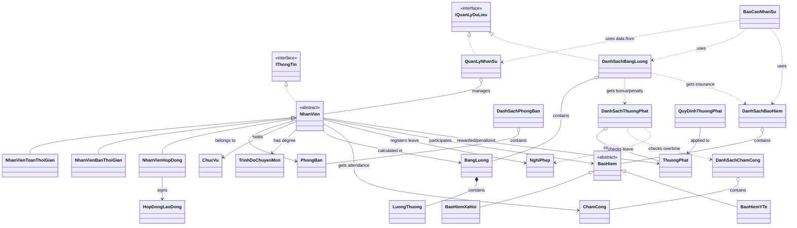

# Hệ thống Quản lý Nhân sự

Ứng dụng quản lý nhân sự viết bằng Java (hướng đối tượng), bao gồm quản lý nhân viên, phòng ban, chấm công, nghỉ phép, bảng lương, thưởng/phạt, bảo hiểm và báo cáo thống kê.

> ⚠️ **Lưu ý:** Tài liệu này được viết dựa trên sơ đồ lớp (class diagram) ở thời điểm hiện tại. Một số thuộc tính/phương thức trong các class **có thể thay đổi** trong quá trình phát triển. Vui lòng cập nhật README này khi code thay đổi.

---

## Mục lục

1. [Tính năng chính](#tính-năng-chính)
2. [Kiến trúc tổng quan](#kiến-trúc-tổng-quan)
3. [Danh sách các class](#danh-sách-các-class)
4. [Quan hệ giữa các class](#quan-hệ-giữa-các-class)
5. [Sơ đồ rút gọn](#sơ-đồ-rút-gọn)

---

## Tính năng chính

- Quản lý hồ sơ nhân viên (toàn thời gian, bán thời gian, hợp đồng)
- Quản lý phòng ban, chức vụ, trình độ chuyên môn
- Chấm công, tính giờ làm và giờ tăng ca
- Đăng ký và duyệt nghỉ phép
- Quản lý hợp đồng lao động
- Tính lương, thưởng, phạt, bảo hiểm
- Thống kê, báo cáo theo tháng/năm, theo phòng ban hoặc toàn công ty
- Đọc/ghi dữ liệu từ file

---

## Kiến trúc tổng quan

Project chia thành 4 nhóm class chính:

| Nhóm | Mô tả | Class |
|------|-------|-------|
| **Interface** | Hợp đồng chung cho các class | `IThongTin`, `IQuanLyDuLieu` |
| **Entity (thực thể)** | Đối tượng nghiệp vụ | `NhanVien` (và các lớp con), `PhongBan`, `ChucVu`, `TrinhDoChuyenMon`, `BangLuong`, `LuongThuong`, `ChamCong`, `NghiPhep`, `HopDongLaoDong`, `ThuongPhat`, `QuyDinhThuongPhat`, `BaoHiem` (và các lớp con) |
| **Quản lý danh sách** | Lưu trữ và thao tác trên tập đối tượng | `QuanLyNhanSu`, `DanhSachPhongBan`, `DanhSachBangLuong`, `DanhSachChamCong`, `DanhSachThuongPhat`, `DanhSachBaoHiem` |
| **Báo cáo** | Tổng hợp thống kê | `BaoCaoNhanSu` |

---

## Danh sách các class

### 1. Interface

#### `IThongTin`
- `+hienThiThongTin() : void`

#### `IQuanLyDuLieu`
- `+docFile() : void`
- `+ghiFile() : void`

> Được cài đặt bởi `QuanLyNhanSu` và `DanhSachBangLuong`.

---

### 2. Nhân viên

#### `NhanVien` *(abstract, implements `IThongTin`)*

**Thuộc tính**
- `-maNV: String`
- `-hoTen: String`
- `-ngaySinh: LocalDate`
- `-gioiTinh: String`
- `-sdt: String`
- `-email: String`
- `-luongCoBan: double`
- `-ngayVaoLam: LocalDate`
- `-trangThai: String`
- `-chucVu: ChucVu`
- `-phongBan: PhongBan`
- `-trinhDo: TrinhDoChuyenMon[]`
- `-soLuongNV: int` *(static)*

**Phương thức**
- `+NhanVien()`, `+NhanVien(maNV, hoTen, ..., luongCoBan)`
- `+tinhLuong() : double` *(abstract)*
- `+hienThiThongTin() : void`
- `+getSoLuongNV() : int` *(static)*
- `+nhap() : void`
- `+chamCong(ngay, gioVao, gioRa) : ChamCong`
- `+tinhThuongPhat(thang, nam) : double`
- `+tinhTienBaoHiem() : double`

#### `NhanVienToanThoiGian` *(extends `NhanVien`)*
- Thuộc tính: `-phuCap: double`, `-thamNien: int`
- Phương thức: `+NhanVienToanThoiGian()`, `+NhanVienToanThoiGian(..., phuCap)`, `+tinhLuong() : double`

#### `NhanVienBanThoiGian` *(extends `NhanVien`)*
- Thuộc tính: `-soGioLam: int`, `-luongTheoGio: double`
- Phương thức: `+NhanVienBanThoiGian()`, `+NhanVienBanThoiGian(..., luongTheoGio)`, `+tinhLuong() : double`

#### `NhanVienHopDong` *(extends `NhanVien`)*
- Thuộc tính: `-thoiHanHopDong: int`, `-luongTheoHopDong: double`, `-ngayBatDauThucTe: LocalDate`, `-ngayKetThucThucTe: LocalDate`, `-thoiGianThucTe: int`
- Phương thức: `+NhanVienHopDong()`, `+NhanVienHopDong(..., thoiHanHopDong)`, `+tinhLuong() : double`, `+tinhThoiGianThucTe() : int`, `+kiemTraDungHan() : boolean`

---

### 3. Tổ chức

#### `PhongBan`
- Thuộc tính: `-maPB: String`, `-tenPB: String`, `-moTa: String`, `-soPB: int` *(static)*
- Phương thức: `+PhongBan()`, `+PhongBan(maPB, tenPB, moTa)`, `+getSoPB() : int` *(static)*, `+hienThiThongTin() : void`, `+demNhanVien() : int`

#### `ChucVu`
- Thuộc tính: `-maCV: String`, `-tenCV: String`, `-heSoLuong: double`
- Phương thức: `+ChucVu()`, `+ChucVu(maCV, tenCV, heSoLuong)`, `+capNhatChucVu() : void`, `+tinhPhuCapChucVu() : double`

#### `TrinhDoChuyenMon`
- Thuộc tính: `-maTD: String`, `-tenTrinhDo: String`, `-chuyenNganh: String`, `-truongDaoTao: String`, `-namTotNghiep: int`, `-heSoTrinhDo: double`
- Phương thức: `+TrinhDoChuyenMon()`, `+TrinhDoChuyenMon(maTD, tenTrinhDo, chuyenNganh, ...)`, `+tinhPhuCapTrinhDo() : double`, `+hienThiThongTin() : void`

---

### 4. Chấm công, nghỉ phép, hợp đồng

#### `ChamCong`
- Thuộc tính: `-maChamCong: String`, `-maNV: String`, `-ngay: LocalDate`, `-gioVao: LocalTime`, `-gioRa: LocalTime`, `-soGioLam: double`, `-gioTangCa: double`, `-trangThai: String`
- Phương thức: `+ChamCong()`, `+ChamCong(maChamCong, maNV, ngay, ...)`, `+ghiNhan() : void`, `+tinhGioLam() : double`, `+tinhGioTangCa() : double`

#### `NghiPhep`
- Thuộc tính: `-maNP: String`, `-maNV: String`, `-ngayBatDau: LocalDate`, `-ngayKetThuc: LocalDate`, `-lyDo: String`, `-loaiNghi: String`, `-trangThai: String`
- Phương thức: `+NghiPhep(maNP, ..., lyDo)`, `+duyetNghiPhep() : void`, `+tinhSoNgayNghi() : int`

#### `HopDongLaoDong`
- Thuộc tính: `-maHD: String`, `-ngayKy: LocalDate`, `-ngayHetHan: LocalDate`, `-loaiHopDong: String`
- Phương thức: `+HopDongLaoDong(maHD, ...)`, `+giaHan() : void`, `+conHieuLuc() : boolean`

---

### 5. Lương – Thưởng/Phạt – Bảo hiểm

#### `BangLuong`
- Thuộc tính: `-maBangLuong: String`, `-maNV: String`, `-thang: int`, `-nam: int`, `-phuCap: double`, `-tienThuong: double`, `-tienPhat: double`, `-tienBaoHiem: double`, `-tongLuong: double`, `-luongThucNhan: double`, `-LUONG_TOI_THIEU: double` *(static)*
- Phương thức: `+BangLuong(maBangLuong, thang, nam)`, `+tinhTongLuong() : double`, `+tinhLuongThucNhan() : double`, `+xuatBangLuong() : void`, `+getLuongToiThieu() : double` *(static)*

#### `LuongThuong`
- Thuộc tính: `-maLT: String`, `-loai: String`, `-soTien: double`, `-lyDo: String`
- Phương thức: `+LuongThuong(maLT, loai, soTien)`, `+tinhThuong() : double`

#### `ThuongPhat`
- Thuộc tính: `-maTP: String`, `-maNV: String`, `-maQD: String`, `-loai: String`, `-lyDo: String`, `-soLuong: double`, `-soTien: double`, `-ngayApDung: LocalDate`
- Phương thức: `+ThuongPhat()`, `+ThuongPhat(maTP, maNV, maQD, ...)`, `+tinhSoTien() : double`, `+hienThiThongTin() : void`

#### `QuyDinhThuongPhat`
- Thuộc tính: `-maQD: String`, `-tenQD: String`, `-loai: String`, `-dieuKien: String`, `-nguong: double`, `-mucTien: double`, `-donVi: String`
- Phương thức: `+QuyDinhThuongPhat()`, `+QuyDinhThuongPhat(maQD, tenQD, loai, ...)`, `+kiemTraDieuKien(giaTri) : boolean`, `+tinhTien(soLuong) : double`, `+laThuong() : boolean`

#### `BaoHiem` *(abstract)*
- Thuộc tính: `-maBH: String`, `-maNV: String`, `-soSo: String`, `-ngayThamGia: LocalDate`, `-trangThai: String`
- Phương thức: `+BaoHiem()`, `+BaoHiem(maBH, maNV, soSo, ngayThamGia)`, `+tinhTienNhanVienDong(luongDongBH) : double` *(abstract)*, `+tinhTienDoanhNghiepDong(luongDongBH) : double` *(abstract)*, `+hienThiThongTin() : void`

#### `BaoHiemXaHoi` *(extends `BaoHiem`)*
- Thuộc tính: `-TY_LE_NV: double` *(static)*, `-TY_LE_DN: double` *(static)*
- Phương thức: `+BaoHiemXaHoi()`, `+tinhTienNhanVienDong(luongDongBH) : double`, `+tinhTienDoanhNghiepDong(luongDongBH) : double`

#### `BaoHiemYTe` *(extends `BaoHiem`)*
- Thuộc tính: `-noiKhamChuaBenh: String`, `-hanTheDen: LocalDate`, `-TY_LE_NV: double` *(static)*, `-TY_LE_DN: double` *(static)*
- Phương thức: `+BaoHiemYTe()`, `+tinhTienNhanVienDong(luongDongBH) : double`, `+tinhTienDoanhNghiepDong(luongDongBH) : double`, `+conHanThe() : boolean`

---

### 6. Các class quản lý danh sách

#### `QuanLyNhanSu` *(implements `IQuanLyDuLieu`)*
- Thuộc tính: `-danhSach: NhanVien[]`, `-soLuong: int`
- Phương thức:
  - `+QuanLyNhanSu(sucChua)`
  - `+nhapDanhSach(n)`, `+xuatDanhSach()`
  - `+themNhanVien(nv) : boolean`, `+themKNhanVien(k)`
  - `+suaNhanVien(maNV) : boolean`, `+xoaNhanVien(maNV) : boolean`
  - `+timKiem(tuKhoa) : NhanVien[]`
  - `+timKiemTheoPhongBan(maPB) : NhanVien[]`
  - `+timKiemTheoLuong(min, max) : NhanVien[]`
  - `+timKiemTheoChucVu(maCV) : NhanVien[]`
  - `+thongKeTheoPhongBan()`, `+thongKeTheoLoaiNV()`, `+thongKeTheoTrangThai()`, `+thongKeLuong()`
  - `+docFile()`, `+ghiFile()`

#### `DanhSachPhongBan`
- Thuộc tính: `-danhSach: PhongBan[]`, `-soLuong: int`
- Phương thức: `+DanhSachPhongBan(sucChua)`, `+nhapDanhSach(n)`, `+xuatDanhSach()`, `+them(pb) : boolean`, `+suaTheoMa(maPB) : boolean`, `+xoaTheoMa(maPB) : boolean`, `+timKiem(tuKhoa) : PhongBan[]`

#### `DanhSachBangLuong` *(implements `IQuanLyDuLieu`)*
- Thuộc tính: `-danhSach: BangLuong[]`, `-soLuong: int`
- Phương thức: `+DanhSachBangLuong(sucChua)`, `+them(bl) : boolean`, `+timTheoMaNV(maNV, thang, nam) : BangLuong`, `+xuatBangLuongNhanVien(maNV)`, `+xuatBangLuongTheoPhong(maPB, thang, nam)`, `+xuatBangLuongCongTy(thang, nam)`, `+tongQuyLuong(thang, nam) : double`, `+luongCaoNhat(thang, nam) : BangLuong`, `+luongThapNhat(thang, nam) : BangLuong`, `+luongTrungBinh(thang, nam) : double`, `+docFile()`, `+ghiFile()`

#### `DanhSachChamCong`
- Thuộc tính: `-danhSach: ChamCong[]`, `-soLuong: int`
- Phương thức: `+DanhSachChamCong(sucChua)`, `+nhapDanhSach(n)`, `+xuatDanhSach()`, `+them(cc) : boolean`, `+xoaTheoMa(ma) : boolean`, `+thongKeGioLam(maNV, thang) : double`, `+thongKeGioTangCa(maNV, thang) : double`, `+thongKeSoNgayDiLam(maNV, thang) : int`

#### `DanhSachThuongPhat`
- Thuộc tính: `-danhSach: ThuongPhat[]`, `-soLuong: int`
- Phương thức: `+DanhSachThuongPhat(sucChua)`, `+them(tp) : boolean`, `+xoaTheoMa(maTP) : boolean`, `+timTheoMaNV(maNV) : ThuongPhat[]`, `+tongThuong(maNV, thang, nam) : double`, `+tongPhat(maNV, thang, nam) : double`, `+tuDongXetThuongPhat(thang, nam)`

#### `DanhSachBaoHiem`
- Thuộc tính: `-danhSach: BaoHiem[]`, `-soLuong: int`
- Phương thức: `+DanhSachBaoHiem(sucChua)`, `+them(bh) : boolean`, `+xoaTheoMa(maBH) : boolean`, `+timTheoMaNV(maNV) : BaoHiem[]`, `+tongTienNhanVienDong() : double`, `+tongTienDoanhNghiepDong() : double`, `+xuatDanhSach()`

---

### 7. Báo cáo

#### `BaoCaoNhanSu`
- Thuộc tính: `-ngayLap: LocalDate`
- Phương thức:
  - `+BaoCaoNhanSu(ql)`, `+BaoCaoNhanSu(ql, dsBangLuong, dsBaoHiem, dsThuongPhat)`
  - `+thongKeTheoPhongBan()`, `+thongKeLuong()`, `+thongKeHoatDongVaNghi()`, `+thongKeBaoHiem()`
  - `+thongKeLuongCaoThapNhat(thang, nam)`
  - `+inBaoCaoToanCongTy(thang, nam)`, `+inBaoCaoTheoPhong(maPB, thang, nam)`
  - `+xuatBaoCao()`

---

## Quan hệ giữa các class

### Kế thừa / Cài đặt (Generalization / Realization)

| Class con | Class cha / Interface |
|-----------|----------------------|
| `NhanVienToanThoiGian`, `NhanVienBanThoiGian`, `NhanVienHopDong` | `NhanVien` (abstract) |
| `BaoHiemXaHoi`, `BaoHiemYTe` | `BaoHiem` (abstract) |
| `NhanVien` | `IThongTin` |
| `QuanLyNhanSu`, `DanhSachBangLuong` | `IQuanLyDuLieu` |

### Kết tập / Hợp thành (Aggregation / Composition)

| Class | Quan hệ | Class | Bội số |
|-------|---------|-------|--------|
| `QuanLyNhanSu` | manages | `NhanVien` | 0..* |
| `DanhSachPhongBan` | contains | `PhongBan` | 0..* |
| `DanhSachBangLuong` | contains | `BangLuong` | 0..* |
| `DanhSachChamCong` | contains | `ChamCong` | 0..* |
| `DanhSachThuongPhat` | contains | `ThuongPhat` | 0..* |
| `DanhSachBaoHiem` | contains | `BaoHiem` | 0..* |
| `BangLuong` | contains *(composition)* | `LuongThuong` | 0..* |

### Liên kết (Association)

| Class | Quan hệ | Class | Bội số |
|-------|---------|-------|--------|
| `NhanVien` | belongs to | `PhongBan` | — / 0..* |
| `NhanVien` | holds | `ChucVu` | — |
| `NhanVien` | has degree | `TrinhDoChuyenMon` | 0..* |
| `NhanVien` | calculated in | `BangLuong` | 1..* |
| `NhanVien` | gets attendance | `ChamCong` | 0..* |
| `NhanVien` | registers leave | `NghiPhep` | 0..* |
| `NhanVien` | participates | `BaoHiem` | 0..* |
| `NhanVien` | rewarded/penalized | `ThuongPhat` | 0..* |
| `NhanVienHopDong` | signs | `HopDongLaoDong` | 1..* |
| `QuyDinhThuongPhat` | applied to | `ThuongPhat` | 0..* |

### Phụ thuộc (Dependency)

| Class | Quan hệ | Class |
|-------|---------|-------|
| `BaoCaoNhanSu` | uses | `DanhSachBangLuong`, `DanhSachBaoHiem` |
| `BaoCaoNhanSu` | uses data from | `QuanLyNhanSu` |
| `DanhSachBangLuong` | queries department | `QuanLyNhanSu` |
| `DanhSachBangLuong` | gets bonus/penalty | `DanhSachThuongPhat` |
| `DanhSachBangLuong` | gets insurance | `DanhSachBaoHiem` |
| `DanhSachThuongPhat` | checks overtime | `DanhSachChamCong` |
| `DanhSachThuongPhat` | checks leave | `NghiPhep` |

---

## Sơ đồ rút gọn

Sơ đồ dưới đây chỉ thể hiện các class và quan hệ chính (đã lược bớt thuộc tính/phương thức).

---

## Ghi chú

- Các tên class, thuộc tính, phương thức được giữ nguyên theo sơ đồ (tiếng Việt không dấu).
- Dấu `...` trong tham số constructor nghĩa là còn các tham số khác chưa liệt kê đầy đủ trong sơ đồ.
- Cấu trúc và chữ ký phương thức có thể được điều chỉnh khi cài đặt thực tế.
